# home-cluster

[](https://github.com/sxi9/home-cluster-/actions/workflows/ci.yml)
-blue)


Pool the RAM, GPUs and CPUs of the laptops and phones you already own into one
cluster, run a language model that is too big for any single device, and watch
it all on one dashboard.

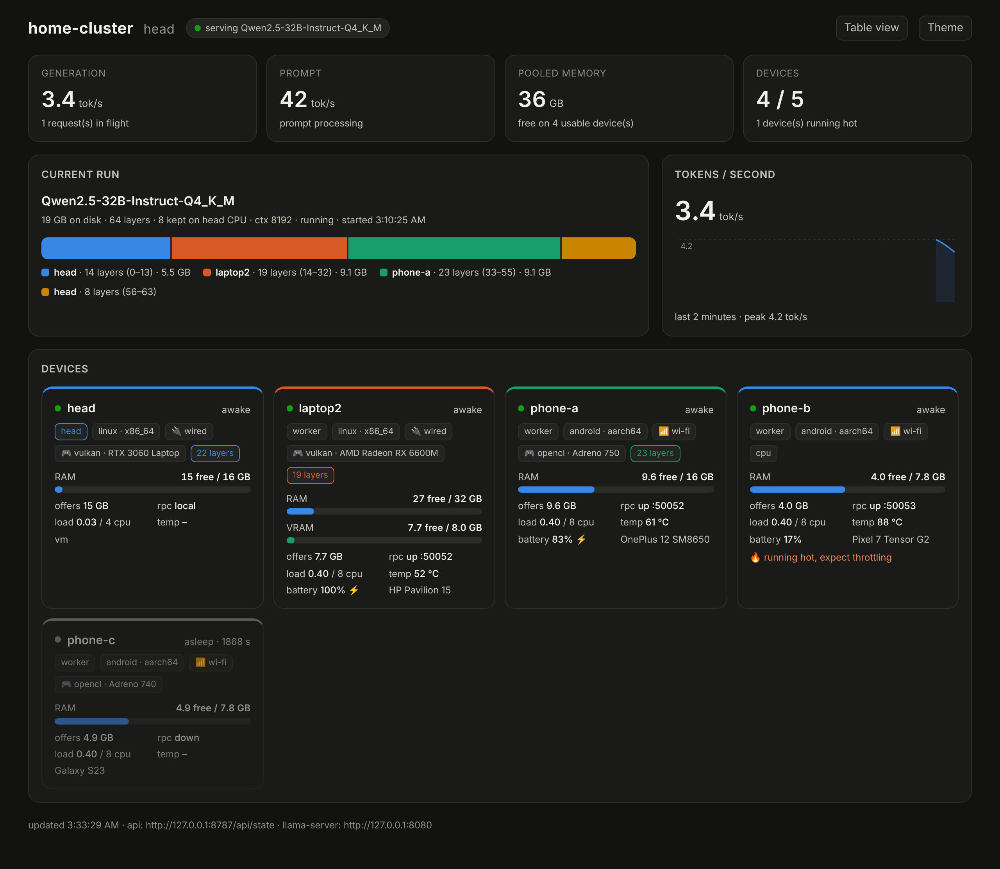

## How it works

```
                 wired LAN (model traffic)  ·  Tailscale (names, ssh, remote)
 ┌──────────────┐        ┌───────────────┐        ┌──────────────┐  ┌──────────────┐
 │ head (Ubuntu)│  rpc   │ laptop (Ubuntu│  rpc   │ phone A      │  │ phone B      │
 │ llama-server │◄──────►│ rpc-server    │◄──────►│ rpc-server   │  │ rpc-server   │
 │ k3s server   │        │ k3s agent     │        │ (Termux)     │  │ (Termux)     │
 │ NFS, models  │        │ cluster-agent │        │ cluster-agent│  │ cluster-agent│
 │ clusterd ─── dashboard, join files, heartbeats ──────────────────────────────── │
 └──────────────┘        └───────────────┘        └──────────────┘  └──────────────┘
```

- **One model, many devices.** `llama.cpp` is built with its RPC backend. Each
  worker runs `rpc-server` and offers its memory. `cluster run model.gguf` on the
  head splits the model's layers across every awake device and starts
  `llama-server` with an OpenAI-compatible API. The model only has to fit in
  the *combined* memory.
- **Bigger, not faster.** Every token walks through every device in turn, so
  throughput is bound by the slowest device and link. The planner fills the
  fastest devices first (head GPU, wired GPU, wired CPU) and only reaches for
  Wi‑Fi devices when the model does not fit otherwise.
- **GPUs of any brand, together.** Each device builds `rpc-server` for its own
  GPU (Vulkan for AMD/NVIDIA/Intel, CUDA, ROCm, Adreno OpenCL on Snapdragon
  phones). The head sees them all as generic remote devices.
- **The head owns all state.** Model files, the k3s token, the NFS share, the
  pinned llama.cpp version and the dashboard live on the head. A worker holds a
  config file, a token and two services, so a wiped device rejoins with one
  command.
- **Master with a fallback.** Any Ubuntu worker can also be a standby head that
  mirrors the share and takes over when the primary is down.
- **Login.** The dashboard and its API are behind an admin password (salted
  hash on the head, week-long sessions); the `cluster` CLI on the head works
  without it.
- **k3s for everything else.** The head is the k3s server, Ubuntu workers are
  agents, so grouped services (anything in a container) can run across them.

## Quick start

**1. Head** (the Ubuntu laptop that stays on):

```bash
git clone https://github.com/sxi9/home-cluster-.git && cd home-cluster-
sudo ./join.sh head --admin-pass 'choose-a-password'    # or: sudo ./head.sh --gpu cuda --admin-pass ...
```

It prints the join commands below with your head's address filled in, and the
dashboard URL `http://HEAD-IP:8787` (login: `admin` and the password you chose;
change it any time with `cluster password`).

**2. Each Ubuntu laptop** (the Windows laptop booted into Ubuntu):

```bash
curl -fsSL http://HEAD-IP:8787/worker.sh | sudo bash
```

**3. Each Android phone, root or not**, with the app: open
`http://HEAD-IP:8787/home-cluster-worker.apk` on the phone, install, enter the
head URL, tap Start. Root is optional; with it the app also protects
`rpc-server` from Android's memory killer. Snapdragon phones use the Adreno
GPU through OpenCL, Mali phones (Exynos, Tensor, MediaTek) use Vulkan, and
anything else uses the CPU, each falling back to the next if a driver
misbehaves. See [docs/android-app.md](docs/android-app.md).

Or, for the Adreno GPU path on a rooted Snapdragon phone, Termux (install
Termux, Termux:Boot and optionally Tailscale from F-Droid first):

```bash
pkg install curl && curl -fsSL http://HEAD-IP:8787/android.sh | bash
```

**3b. A Windows PC without rebooting** (model pool only, elevated PowerShell;
uses the official prebuilt llama.cpp release matching the head's pin):

```powershell
powershell -ExecutionPolicy Bypass -c "iwr -useb http://HEAD-IP:8787/worker.ps1 -OutFile $env:TEMP\worker.ps1; & $env:TEMP\worker.ps1"
```

**4. Run a model** on the head:

```bash
cp Qwen2.5-32B-Instruct-Q4_K_M.gguf /srv/cluster/models/
cluster nodes                               # who is awake and what they offer
cluster plan  Qwen2.5-32B-Instruct-Q4_K_M.gguf   # see the split, change nothing
cluster run   Qwen2.5-32B-Instruct-Q4_K_M.gguf   # start it
curl http://HEAD-IP:8080/v1/chat/completions -d '{"messages":[{"role":"user","content":"hi"}]}'
```

Faster and friendlier:

```bash
cluster run big.gguf --draft small.gguf   # speculative decoding: the biggest tok/s win on an RPC chain
cluster ui                                # Open WebUI on k3s at http://HEAD-IP:30080
cluster models                            # what is in the share and whether it fits right now
```

**4b. Measure, then tune.** Every device is only as useful as its speed and its link:

```bash
cluster bench                 # tok/s of each device over RPC, link RTT and bandwidth; flags the slowest
cluster tune                  # show optimization settings and what they do
cluster tune KV_CACHE_TYPE=q8_0 FLASH_ATTN=on WIFI_MAX_PCT=20
cluster top                   # process manager: what is eating RAM/CPU on every device, with alerts
cluster kill phone-b 2990     # kill a process on a device
```

After `cluster bench`, the planner orders devices by measured speed instead of
the wired/GPU heuristic, and the dashboard marks the slowest device with 🐢.

**4c. Optimize everything at once:**

```bash
cluster tune --auto    # flash attention if GPUs exist, q8_0 KV cache, bench ordering, Wi-Fi cap,
                       # head threads, mlock when RAM allows, phone-friendly batches; explains each choice
```

**4d. A fallback head** (master/standby), on a second Ubuntu machine that is
already a worker:

```bash
curl -fsSL http://HEAD-IP:8787/join.sh | sudo bash -s standby
```

If the primary head goes silent for about 40 seconds, the standby starts
serving the dashboard, join files and `cluster run`; every device's agent
follows it automatically and returns when the primary is back. Details and
limits in [docs/failover.md](docs/failover.md).

**5. One controller for every device**, from the head:

```bash
cluster exec --all -- uptime                       # any command on every device over ssh
cluster exec phone-a -- 'sv status rpc-server'     # or one device
cluster restart --all                              # restart rpc-server + agent everywhere
cluster ssh laptop2                                # interactive shell
```

Workers authorise the head's ssh key when they join (root on Ubuntu, the
Termux user on phones, sshd on port 8022). Windows workers are managed with
their own scheduled tasks and are not reachable this way.

No flags are needed anywhere: the served scripts carry the head's address,
workers fetch the token and version pins from the head, and generic hostnames
are replaced with stable ones. Every script has `--dry-run` (prints what it
would do) and `--leave` (undoes it). Settings are saved, so re-running a script
with no arguments after a reboot or wipe just works.

## Dashboard

Served by the head at `http://HEAD-IP:8787`. Live every 2 seconds, no external
dependencies, works offline on the LAN and over Tailscale.

| | |
|---|---|
| 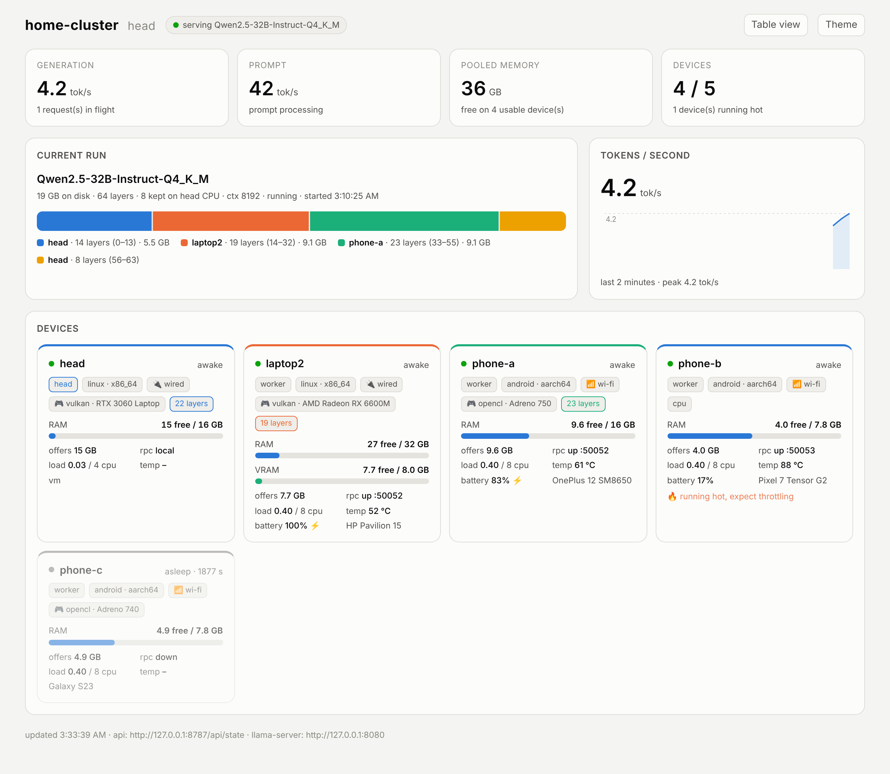 | 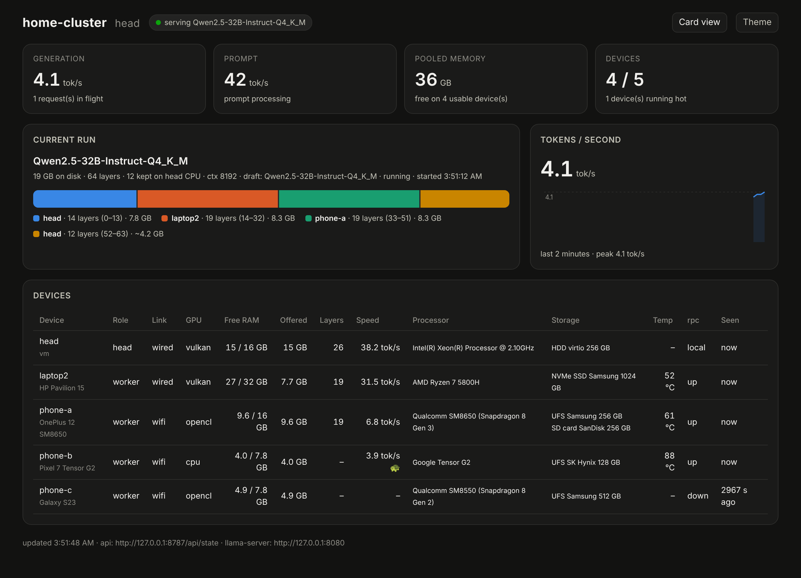 |
| Light theme (follows the OS, toggle on the page) | Table view of every device |

- Per device: role, OS, link (wired / Wi‑Fi), GPU, free RAM and VRAM, what it
  offers to the model, rpc-server state, load, temperature, battery, and the
  layers it holds in the current run. Devices that stop heartbeating fade out.
- Current run: model, context, the layer split as a bar (one colour per
  device), how many layers stayed on the head's CPU, and the bytes llama.cpp
  actually placed on each device.
- Tokens per second for generation and prompt processing, with a two-minute
  sparkline. The numbers come from `llama-server`'s own metrics endpoint.
- Warnings when a phone runs hot or its battery is low and not charging.
- Measured speed per device (tokens/sec over RPC, link RTT and bandwidth) with
  the slowest device flagged, since the chain runs at its pace.
- Processor and every storage device with its kind (NVMe, SSD, HDD, eMMC, UFS,
  SD card), vendor, size and free space, including SD cards in phones.
- A process panel per device: top processes by memory with CPU%, alerts when a
  non-cluster process hogs RAM or CPU, and the exact `cluster ssh` / `cluster kill`
  commands for that device.

| 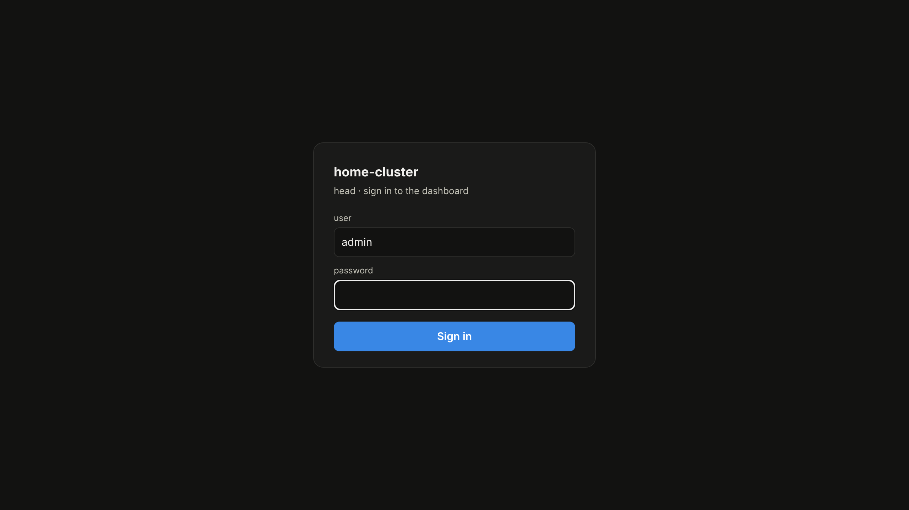 | 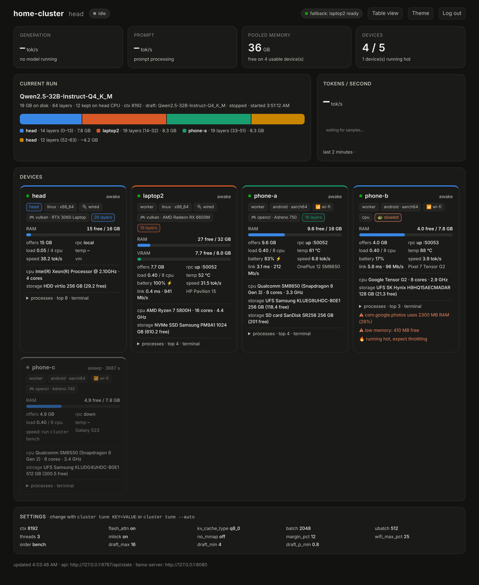 |
|---|---|
| Login (admin + the password set at install) | Fallback head in the header pill, settings panel at the bottom |

<details><summary>Phone-sized view</summary>

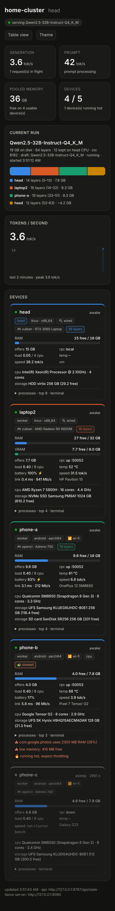
</details>

## Real test in the cloud

The whole model path was run for real in this project's build container (no
systemd, no GPU, so the service scripts were dry-run only): llama.cpp was
built from master, two real `rpc-server` processes acted as workers, and a real
Qwen2.5 0.5B model was split 11 + 11 + 2 layers across them and the head.

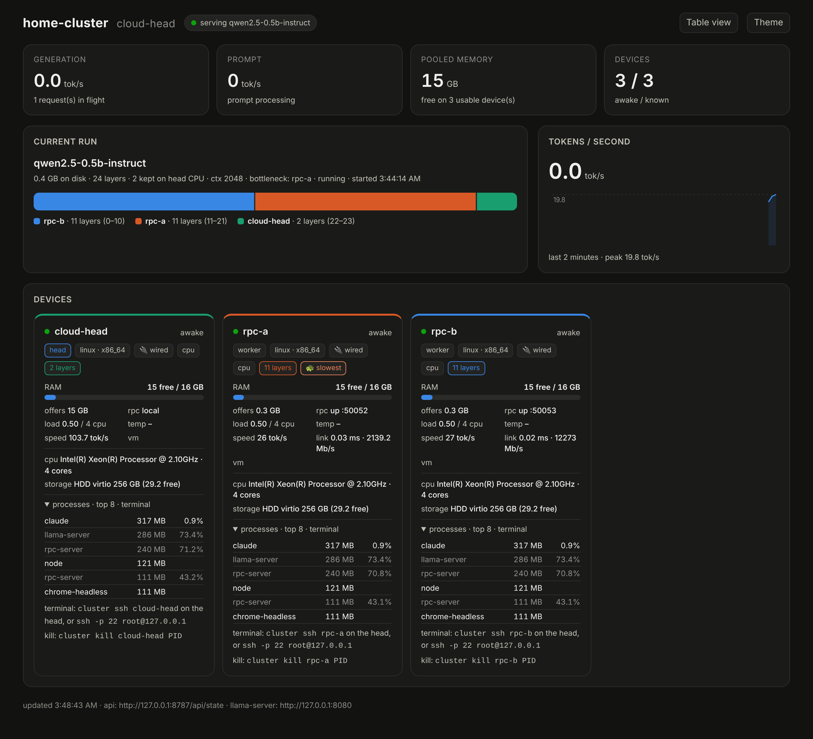

| what | result |
|---|---|
| `cluster bench` | head 103.7 tok/s, each rpc worker ~26 tok/s over RPC; slowest flagged |
| `cluster run` | planner split 11/11/2, `llama-server` started with `--rpc` + `--device RPC0,RPC1` + `--tensor-split` |
| chat completion | real answer through both workers at 16.9 tok/s (bigger, not faster: 103.7 on the head alone) |
| dashboard | live tok/s from llama-server metrics, layer bar, speed, processes, hardware |

Bugs the real binaries caught, all fixed: the rpc-server binary was renamed to
`ggml-rpc-server`, `--mem` was removed from it, RPC devices are now named
`RPC0, RPC1…`, the speculative flags became `--spec-draft-n-max/min`, and the
default build is shared libraries (the scripts now build static). See
[docs/network.md](docs/network.md) for how the devices connect.

## The Android app, running

Captured in an Android emulator in this project's build container (software
emulation, so slow): the app's `rpc-server` is up and serving, the foreground
notification keeps it alive, and the status screen shows the llama.cpp commit
it was built from.

| 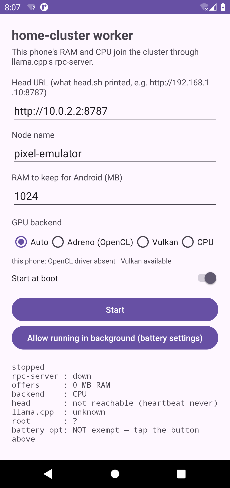 | 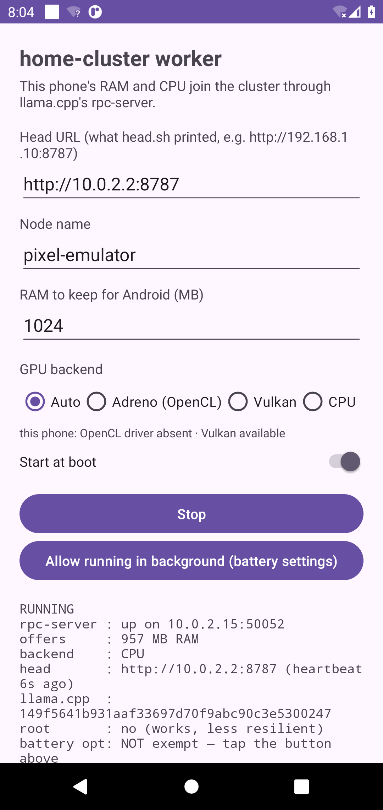 | 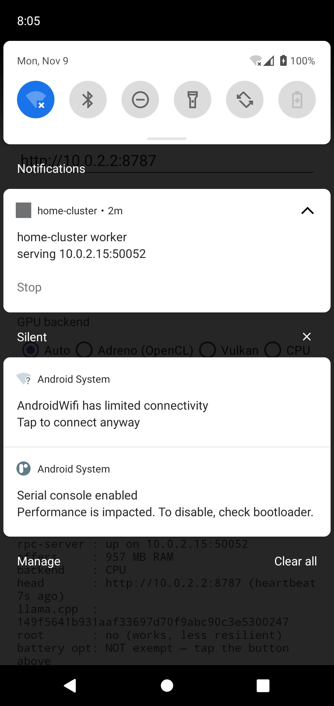 |
|---|---|---|
| setup: head URL, name, RAM to keep, GPU backend | running: rpc-server up, offered RAM, head heartbeat, llama.cpp commit, root state | the persistent notification with its Stop action |

And the same emulator as the head's dashboard shows it, from the app's own
heartbeats (RAM, offered memory, rpc state, battery, temperature, CPU,
storage):

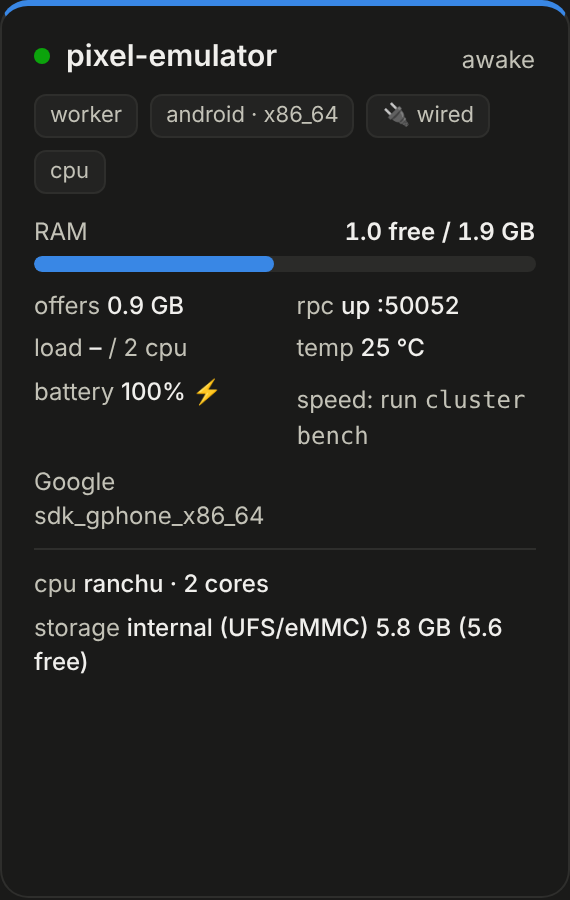

## What is in the repo

| file | runs on | purpose |
|---|---|---|
| `join.sh` | any | `join.sh head \| worker \| android`, from a checkout or piped from the head |
| `head.sh` | head | k3s server, NFS export, llama.cpp build, clusterd, join files, pins |
| `worker.sh` | Ubuntu workers | packages, Tailscale, NFS mount, rpc-server build + service, agent, k3s agent |
| `android.sh` | Termux phones | rpc-server build (Adreno OpenCL or CPU), termux-services, boot start, sshd, root tweaks |
| `android-app/` | any arm64 Android phone | Kotlin app with rpc-server inside; root optional; built by CI, served by the head |
| `releases/home-cluster-worker.apk` | phones | the current app build (llama.cpp b12098, CPU + Adreno OpenCL + Vulkan) |
| `worker.ps1` | Windows PCs | native worker: prebuilt llama.cpp release, startup tasks, heartbeat agent; model pool only |
| `k8s/open-webui.yaml` | head (k3s) | Open WebUI deployment applied by `cluster ui` |
| `bin/cluster` | head | `nodes`, `plan`, `run`, `status`, `stop`, `logs`, `models`, `bench`, `tune [--auto]`, `top`, `kill`, `ui`, `exec`, `restart`, `ssh`, `share`, `password`, `failover` |
| `head/clusterd.py` | head | one service: join files, heartbeats, `/api/state`, login, the dashboard |
| `head/cluster-failover.py` | standby head | watchdog: promotes the standby when the primary is silent, steps down when it returns |
| `docs/failover.md` | you | how master/fallback works and what it cannot do |
| `dashboard/index.html` | head | the dashboard page |
| `agent/cluster-agent.py` | every node | `/metrics` endpoint + heartbeat; standard library only |
| `tests/smoke.sh` | dev | end-to-end test with fake nodes and a fake llama-server; runs in CI |
| `docs/network.md` | you | diagram of how the devices connect, what travels where, every port |
| `CHECKLIST.md` | you | per-device setup checklist and build progress |
| `CLAUDE.md`, `docs/SESSION-LOG.md` | you + Claude | project memory: decisions, conventions, the design conversation |
| `docs/` | you | GPU and phone details, troubleshooting |

## GPU support

| device | backend | flag | notes |
|---|---|---|---|
| any AMD / NVIDIA / Intel GPU | Vulkan | `--gpu vulkan` (auto when a GPU is present) | one build for every vendor, no CUDA/ROCm install |
| NVIDIA with CUDA toolkit | CUDA | `--gpu cuda` | fastest on NVIDIA; needs `nvcc` |
| AMD with ROCm | HIP | `--gpu hip` | needs `/opt/rocm`; picky about cards |
| Snapdragon phone | Adreno OpenCL | `--gpu opencl` (auto on Snapdragon) | shares the phone's RAM, adds compute only |
| anything | CPU | `--gpu cpu` | |

A GPU's VRAM is added to the pool and its layers run much faster than on CPU.
Phone GPUs use unified memory, so they do not add capacity. Details and
measured caveats in [docs/gpu-and-phones.md](docs/gpu-and-phones.md).

## Remote and public access

Everything is designed for the home LAN. For use away from home:

```bash
cluster share              # dashboard + Open WebUI on your tailnet (Tailscale Serve), HTTPS, nothing public
cluster share --public     # Open WebUI also on the internet via Tailscale Funnel, behind its own login
cluster share off
```

Do not put the head on a public IP or port-forward to it. Port 8787 serves the
k3s token, `rpc-server` has no authentication, and `llama-server` has no login.
The per-token model traffic between devices must stay on the LAN anyway; it is
far too chatty for the internet. Tailscale gives you the dashboard, the API,
`cluster ssh`, and the chat UI from anywhere without opening a single port.

## Honest status

- The model path (rpc-server, planner, llama-server, dashboard metrics) was
  verified for real in the cloud, see above. The install scripts have only
  been dry-run: systemd units, k3s, NFS, Tailscale and the phone build need the
  real laptops and a phone. See [CHECKLIST.md](CHECKLIST.md).
- Phones join the model pool and the dashboard, but not k3s. Stock Android
  kernels lack what k3s needs. `android.sh --chroot` sets up an Ubuntu chroot
  for experiments, nothing more.
- The Android app compiles and packages a real arm64 `rpc-server` (verified
  here), but it has not been installed on a phone yet.
- Windows joins either by booting into Ubuntu (full worker with k3s) or
  natively with `worker.ps1` (model pool only). `worker.ps1` could not be
  syntax-checked here (no PowerShell in the build container).
- iOS cannot run any of this without a custom app. See the roadmap.
- The k3s token travels over the home LAN in the clear from the head's join
  service (the join files are the only unauthenticated part of port 8787).
  Keep the port inside the LAN; the scripts add ufw rules for that.

## Roadmap: what else can be added

- **iOS / iPadOS**: a small sideloaded app embedding llama.cpp's rpc-server and
  the agent. No root needed, but it needs Xcode and an Apple ID to sideload.
- **Better splitting**: [prima.cpp](https://github.com/OpenCPIL/prima.cpp)
  claims 5 to 17 times lower latency than plain llama.cpp RPC on exactly this
  kind of mixed home cluster, with Android support. Worth a bake-off once the
  cluster runs.
- **Speculative decoding tuning** per model pair; **KV cache quantization**
  and flash attention flags passed through `cluster run -- ...`.
- **More in k3s**: Longhorn or NFS-backed volumes, Pi-hole, Home Assistant,
  Immich, media servers, running across the Ubuntu nodes.
- **Wake-on-LAN** from the dashboard for sleeping laptops, and a thermal-aware
  planner that drops a phone when it throttles.
- **Prometheus and Grafana** fed from the agents and llama-server, if you want
  history beyond the dashboard's live view.
