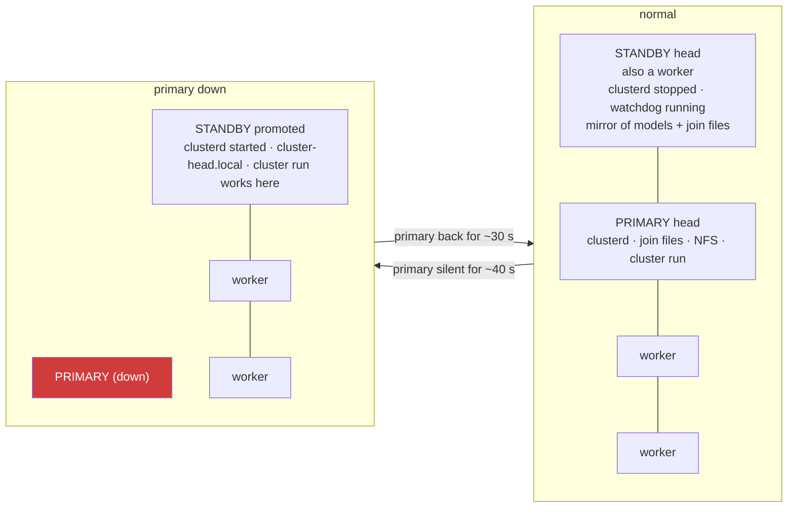

# Master / fallback (failover)

The head is the master: it runs the dashboard, the join service, the NFS share
and `cluster run`. If it dies, the cluster is useless until it is back, unless
another Ubuntu machine is a **standby head**.



## Set it up

On a second Ubuntu machine that is already a worker:

```bash
curl -fsSL http://PRIMARY-IP:8787/join.sh | sudo bash -s standby
```

That runs `worker.sh` (if not yet) and `head.sh --standby PRIMARY-IP`, which:

- builds llama.cpp here too (same pinned commit), installs `clusterd`, the
  `cluster` command and the dashboard, but leaves `clusterd` **stopped**;
- mirrors `/mnt/cluster` (the primary's NFS share) to the local `/srv/cluster`
  every 10 minutes: models, join files, `cluster.env`;
- runs `cluster-failover.service`, the watchdog;
- marks this machine `STANDBY=1` in its worker config, so its agent announces
  itself as a fallback and the primary lists it in every heartbeat response.

## What happens

1. Every agent on every device heartbeats to the primary. The reply carries the
   list of standby heads. Agents remember it on disk.
2. The watchdog on the standby checks the primary's `/api/health` every 10 s.
   After 4 misses (about 40 s) it **promotes**: starts `clusterd` and the
   `cluster-head.local` alias, and records the state.
3. Agents that cannot reach the primary send their heartbeats to the first
   standby that answers. The dashboard on the standby shows a red
   **FAILOVER ACTIVE** banner and every device that has found it.
4. On the standby you run `cluster run model.gguf` as usual; models are in its
   mirrored share. `rpc-server` on every worker does not care which head
   connects.
5. When the primary answers again for 3 checks (about 30 s), the standby
   **steps down** (stops `clusterd`), and the agents, which always try the
   primary first, return to it on their next heartbeat.

Manual control on the standby: `cluster failover status`, `cluster failover
promote`, `cluster failover demote`, `cluster failover auto` (resume automatic).

## What does not fail over

- **k3s.** Real k3s high availability needs three servers with embedded etcd;
  two laptops cannot give quorum. The standby stays a k3s agent. If the primary
  dies, pods on workers keep running but nothing can be scheduled or changed
  until it is back.
- **The NFS share itself.** Workers mount the primary's share. On the standby
  the models come from its mirror; workers' `/mnt/cluster` is unavailable while
  the primary is down.
- **A run in progress.** `llama-server` runs on whichever head started it; if
  that head dies the run dies. Start it again on the standby.
- **The dashboard login.** Each head has its own password hash; set the same
  password on both with `cluster password`.

## Split brain

If the LAN splits so that the standby cannot see the primary while workers can
see both, the standby promotes itself and both heads serve. Agents prefer the
primary, so the workers follow it; the standby's dashboard will show fewer
devices. It resolves itself when the link heals. Do not run `cluster run` on
both heads at once: `rpc-server` serves one client at a time.
