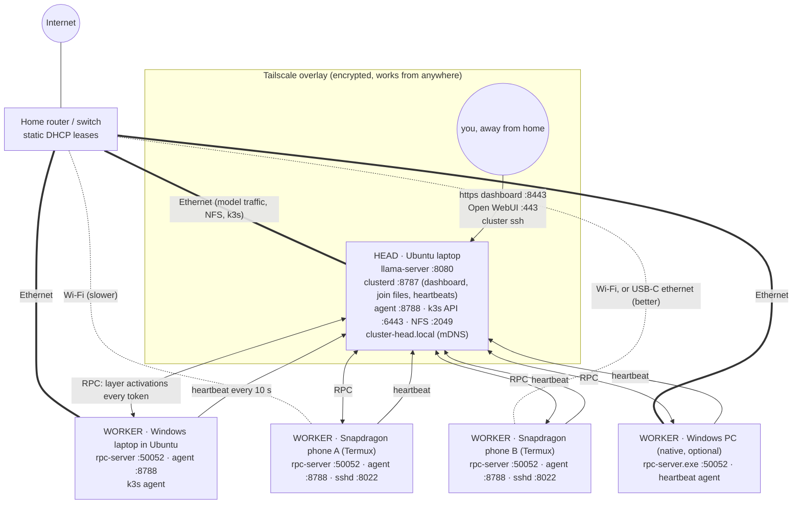

# How the devices are connected

Two networks carry different kinds of traffic. The **wired LAN** (your home
router or a switch) carries the heavy per-token model traffic between devices.
**Tailscale** is an overlay on top: it gives every device a stable name and
encrypted reachability from anywhere, and is used for ssh, the dashboard, the
API and the chat UI when you are away from home. Model traffic never goes
through Tailscale.

## What travels where

| traffic | path | why it matters |
|---|---|---|
| model layers at load time | head → each worker over RPC | tens of GB once per `cluster run`; wired makes this minutes, Wi‑Fi much longer (`--rpc-cache` on a worker keeps a local copy) |
| activations per token | head ↔ worker ↔ worker, in layer order | small, but one round-trip per device per token: **latency** of the slowest link sets the tokens/sec ceiling |
| heartbeats | worker → head :8787 every 10 s | a few KB; this is how the dashboard and the planner know who is awake |
| join files + token | head :8787 → worker, once | plain HTTP on the LAN; keep the port LAN-only |
| NFS share | head :2049 → Ubuntu workers | models and shared state; phones do not mount it |
| k3s | head :6443 ↔ Ubuntu workers :10250, flannel :8472/udp | grouped services; not phones, not native Windows |
| remote access | Tailscale only | dashboard, API, ssh, chat UI; never port-forward the LAN ports |

## Addresses and names

- Every device keeps the same LAN IP through a **static DHCP lease** on the
  router; `rpc-server` binds to that IP, and `cluster run` uses it in `--rpc`.
- The head publishes **`cluster-head.local`** over mDNS for laptops. Phones
  cannot resolve `.local`, so the join command the head prints carries its IP.
- Tailscale MagicDNS names (`head`, `laptop2`, …) are used for ssh and remote
  access; `tailscale up --ssh` on every device means no key distribution for
  your own logins. `cluster exec` uses the head's own key over the LAN IPs.

## Ports (LAN, inbound)

| port | on | for |
|---|---|---|
| 8787/tcp | head | clusterd: dashboard, join files, heartbeats |
| 8080/tcp | head | llama-server (OpenAI-compatible API) |
| 30080/tcp | head | Open WebUI (k3s NodePort) |
| 6443, 10250/tcp, 8472/udp | head + Ubuntu workers | k3s |
| 2049/tcp | head | NFS |
| 5353/udp | head | mDNS |
| 50052/tcp | every worker | rpc-server (no auth: LAN only) |
| 8788/tcp | every node | cluster-agent `/metrics` and bandwidth probe |
| 22/tcp, 8022/tcp | Ubuntu workers / phones | ssh for `cluster exec` |

The scripts add `ufw` rules for exactly these, restricted to the LAN subnet,
plus ssh, dashboard and llama-server on the `tailscale0` interface.
